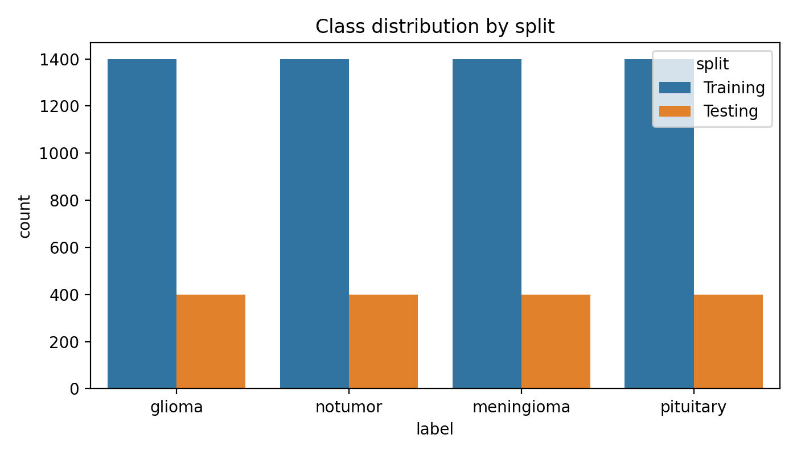
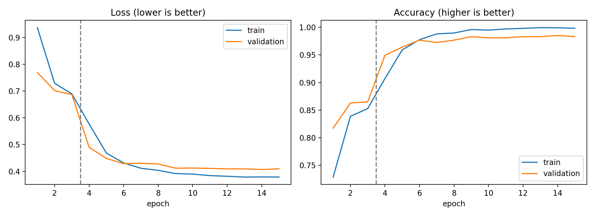
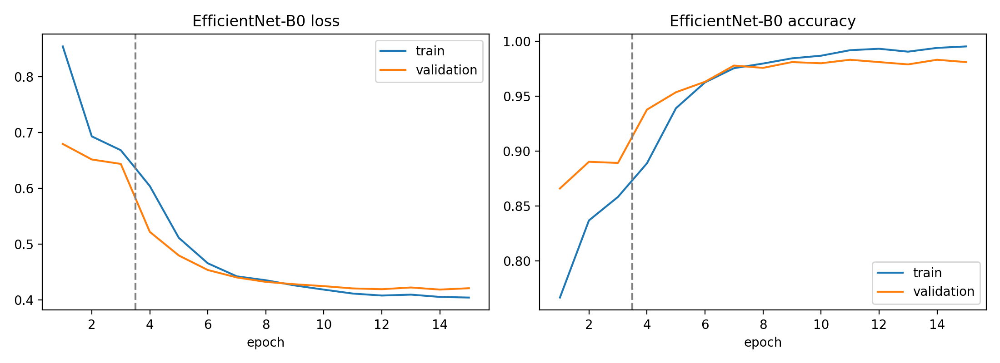
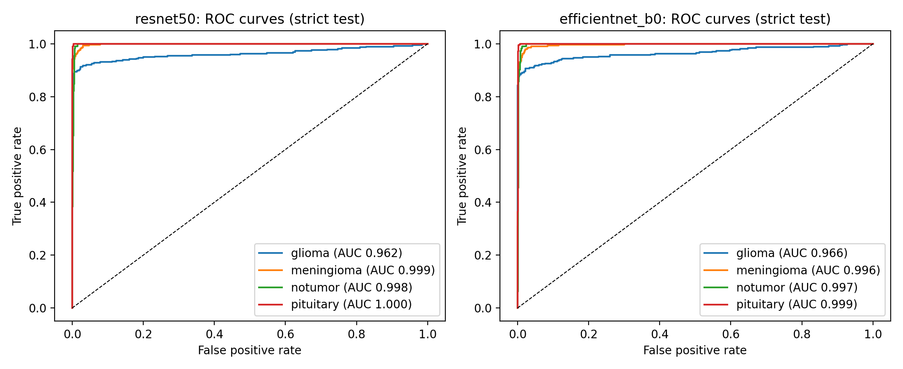
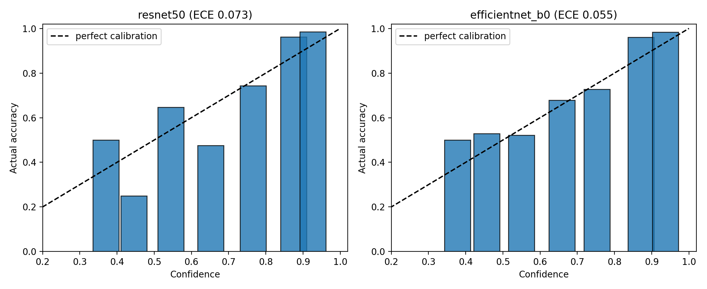
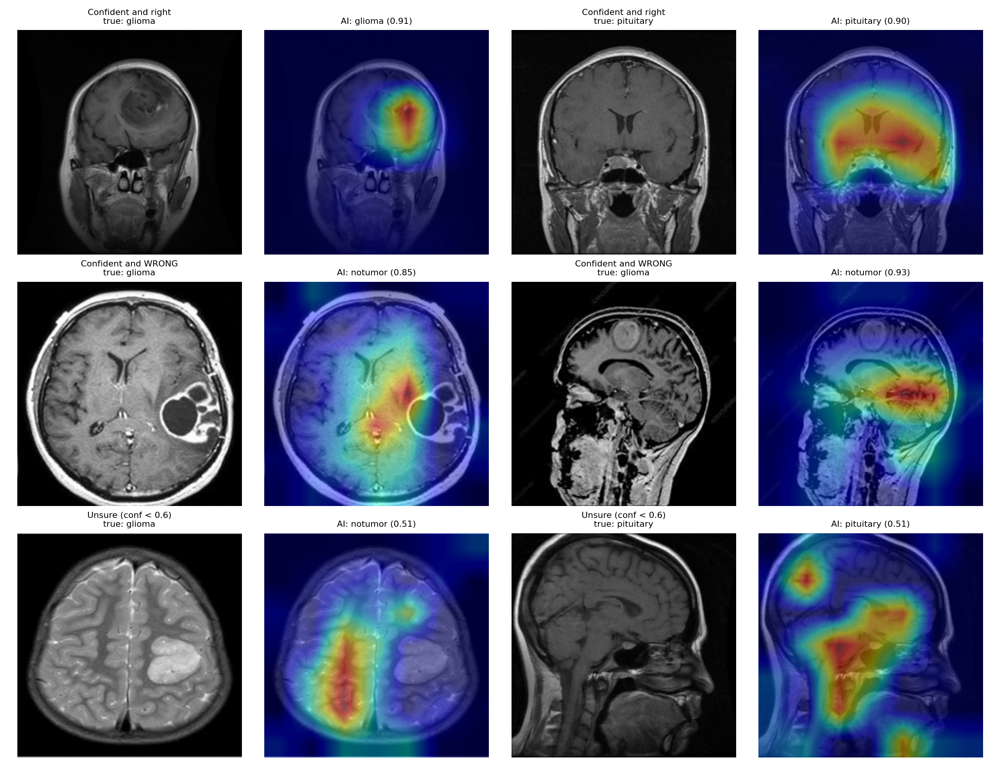
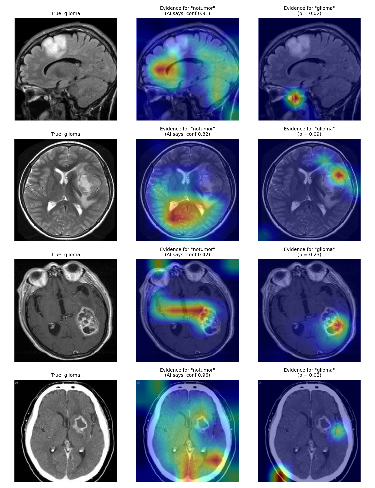

# Explainable Brain MRI Classification with Grad-CAM

**Towards Explainable and Trustworthy Medical Computer Vision Systems**


A research-style study of 4-class brain tumor MRI classification (glioma, meningioma, pituitary tumor, no tumor) using transfer learning (ResNet-50, EfficientNet-B0) and Grad-CAM. The project asks not only *how accurate* the models are, but whether their **data, confidence, and explanations can be trusted**.

> **Research demo only. Not a medical device and not medical advice.**

**Live demo:** coming soon  
**Model weights:** coming soon  
**Author:** YOUR NAME ([GitHub](https://github.com/Emaan-Shahid/Medical-Vision-AI-XAI.git))

---

## 1. Summary of findings

| # | Finding |
|---|---|
| 1 | **The public dataset had serious leakage.** 23% of the official test images (370 of 1,600) had an exact copy in the training set, and 49% of the `notumor` training images were duplicates. The "perfectly balanced" class counts came partly from duplication. |
| 2 | **Labels are entangled with image source.** A random forest using only file metadata (size, dimensions, color mode) reached 58% accuracy against 25% chance, and found `notumor` with 97% recall, without seeing a pixel. |
| 3 | **Both models reach about 95% accuracy on a leak-free test set** (ResNet-50 95.1%, EfficientNet-B0 94.5%, strict test set, n = 1,180). EfficientNet-B0 has about 6x fewer parameters. The difference between the two models is within noise. |
| 4 | **Headline accuracy hides a clinically important weakness.** About 1 in 10 gliomas (37 of 377) was labeled "no tumor", often with high confidence. Validation scores (glioma recall 99.6%) had hidden this. |
| 5 | **Confidence is informative but not a safe alarm.** Mean confidence was 0.89 on correct and 0.75 on wrong predictions, yet 27 of 58 errors had confidence above 0.8. Temperature scaling improved ECE but made wrong predictions *more* confident. |
| 6 | **Models are fragile to blur and noise** (mild blur drops accuracy to 54 to 65%), and a photo of a handwritten page was classified "no tumor" with 100% confidence. |
| 7 | **Grad-CAM suggests where the misses come from.** For missed gliomas, more of the evidence lay outside the head (mean 25% vs 7%, two-sided p = 0.069). This is suggestive, not conclusive. |

---

## 2. Problem statement and motivation

Deep CNNs reach high accuracy on medical image benchmarks, but accuracy alone is not enough for clinical trust. A model can be (a) graded on data it has memorized, (b) overconfident, (c) dependent on cues unrelated to disease (scanner, image format, source), or (d) brittle under small changes in image quality. A black-box output also gives a clinician no way to check the reasoning.

**Research questions**

1. Can the benchmark be trusted? How much leakage and source bias does it contain?
2. How do two transfer-learned CNNs (ResNet-50, EfficientNet-B0) compare on a leak-free test set?
3. Is the models' confidence calibrated, and how robust are they to image degradation?
4. Where do the models look, and does the explanation differ for correct and incorrect predictions?

---

## 3. Dataset and audit

**Data:** [Brain Tumor MRI Dataset](https://www.kaggle.com/datasets/masoudnickparvar/brain-tumor-mri-dataset) by Masoud Nickparvar (Kaggle, CC BY 4.0). 7,200 images: 5,600 training and 1,600 test (1,400 and 400 per class). It is a merged collection from several public sources.

### 3.1 Properties
- Image sizes range from 150x167 to 1375x1446 px (mean about 453x457).
- Color modes: 4,129 RGB, 3,067 grayscale, 3 RGBA, 1 palette. All images are converted to 3-channel RGB.
- `notumor` images are about 40% smaller on average (308x319 vs about 500x500 for the other classes) and 98% RGB files, versus 22% for glioma.

### 3.2 Duplicate and leakage audit
Each image was fingerprinted with a perceptual hash (pHash, 64 bit). Images with Hamming distance 0 were treated as copies. Distance 4 was tested as a sensitivity analysis and rejected as the main rule, because label conflicts rose from 1 to 25 groups, which suggests it also matches merely similar slices.

| Result (distance 0) | Value |
|---|---|
| Test images with a copy in the training set | 370 / 1,600 (23%) |
| `notumor` test images with a training copy | 257 / 400 (64%) |
| `meningioma` test images with a training copy | 105 / 400 (26%) |
| `glioma` / `pituitary` test images with a training copy | 6 / 400 and 2 / 400 |
| Duplicated images inside the test set | 126 |
| `notumor` training images that were redundant copies | about 49% |

**Cleaning rule.** The official test set is never altered. Training images that duplicate a test image, one image with a conflicting label, and within-training duplicates were removed, leaving **4,738 of 5,600** training images.

| Class | Original training | After cleaning |
|---|---|---|
| glioma | 1,400 | 1,393 |
| pituitary | 1,400 | 1,348 |
| meningioma | 1,400 | 1,277 |
| notumor | 1,400 | **720** |

Models are evaluated on three test sets:

| Test set | Images | Definition |
|---|---|---|
| Full | 1,600 | Official test folder |
| Clean | 1,230 | No copy in the original training set |
| **Strict** (headline) | **1,180** | Clean, and without repeated test images (glioma 377, meningioma 293, notumor 112, pituitary 398) |



### 3.3 Metadata-only shortcut test
A random forest on `width, height, aspect ratio, file size, is_rgb` (no pixel content) was trained on the cleaned training set.

| | Accuracy |
|---|---|
| Full test | 58.3% |
| Clean test | 55.0% |
| Chance | 25% |

`notumor` was recovered with 97% recall (389 / 400). This shows that labels are entangled with source and format, so a CNN *could* take a shortcut. It does not show that the CNN does.

---

## 4. Methods

**Split.** Cleaned training set split 80/20, stratified, seed 42: 3,790 train / 948 validation. The test set is used once, for reporting.

**Preprocessing.** Convert to RGB, resize to 224x224, normalize with ImageNet mean and std.

**Augmentation (training only, mild).** Random resized crop (scale 0.85 to 1.0), horizontal flip, rotation up to 15 degrees, brightness and contrast jitter 0.2. No vertical flips or strong distortions.

**Models.** ImageNet-pretrained ResNet-50 (23.5M parameters) and EfficientNet-B0 (4.0M), with the final layer replaced by a 4-class head.

**Training (identical for both).**
- Stage 1: backbone frozen, only the new head trained, 3 epochs, lr 1e-3.
- Stage 2: all layers unfrozen, up to 12 epochs, lr 1e-4, cosine schedule.
- AdamW (weight decay 1e-4), batch size 32, mixed precision, label smoothing 0.1.
- Class-weighted cross-entropy (glioma 0.85, meningioma 0.93, notumor 1.64, pituitary 0.88) to handle the imbalance created by deduplication.
- Best checkpoint chosen by validation loss. Early stopping (patience 4) was configured but never triggered. One training run per model (single seed).

**Metrics.** Accuracy, macro precision, macro recall, macro F1, macro one-vs-rest ROC-AUC, confusion matrices, per-class recall. Calibration: expected calibration error (ECE, 10 bins) and reliability diagrams. Robustness: accuracy under perturbed test images.

**Grad-CAM.** Implemented from scratch (hooks on the last convolutional block): channel weights are the spatially averaged gradients of the class score, the heatmap is `ReLU(sum_k w_k A_k)` upsampled to 224x224 and normalized to [0, 1]. Validated against the `pytorch-grad-cam` library (correlation about 1.00 on 8 images).

---

## 5. Results

### 5.1 Test performance (macro averages, %)

| Model | Test set | n | Accuracy | Precision | Recall | F1 | ROC-AUC |
|---|---|---|---|---|---|---|---|
| ResNet-50 | Full | 1,600 | 94.2 | 94.7 | 94.2 | 94.2 | 0.988 |
| ResNet-50 | Clean | 1,230 | 94.6 | 92.4 | 95.7 | 93.4 | 0.989 |
| ResNet-50 | **Strict** | 1,180 | **95.1** | 92.1 | 96.0 | 93.4 | 0.990 |
| EfficientNet-B0 | Full | 1,600 | 93.5 | 94.2 | 93.5 | 93.5 | 0.987 |
| EfficientNet-B0 | Clean | 1,230 | 94.0 | 91.7 | 95.2 | 92.8 | 0.990 |
| EfficientNet-B0 | **Strict** | 1,180 | **94.5** | 91.5 | 95.6 | 92.9 | 0.990 |

On a test set of this size, an accuracy near 95% has an uncertainty of roughly +/-1.2 points (95% binomial interval), so the 0.6-point gap between models is not meaningful. Macro precision is lower than macro recall on the strict set because few `notumor` images remain (112), so the 37 glioma images labeled "no tumor" weigh heavily on `notumor` precision (112 of 151 predicted, about 74%).




### 5.2 Per-class recall and confusion (strict test set)

| Class | ResNet-50 recall | EfficientNet-B0 recall |
|---|---|---|
| glioma (377) | **86.5%** | **84.4%** |
| meningioma (293) | 97.6% | 98.6% |
| notumor (112) | 100% | 100% |
| pituitary (398) | 100% | 99.5% |

For glioma, ResNet-50 predicted 326 correct, 14 meningioma, **37 notumor**. EfficientNet-B0 predicted 318 correct, 21 meningioma, **37 notumor**, 1 pituitary. The largest error is therefore glioma labeled "no tumor", not glioma/meningioma confusion as expected beforehand.




**Validation overstated glioma performance:** glioma recall was 99.6% (ResNet-50) and 98.2% (EfficientNet-B0) on validation, versus 86.5% and 84.4% on the strict test set. Likely reasons are that validation images come from the same pool and probably the same patients and sources as training images (the dataset has no patient IDs), but this was not verified.

### 5.3 Where the glioma errors come from
- 31 of the 37 missed gliomas are the same images for both models.
- **All 37 misses are gliomas stored as RGB files; none of the 226 grayscale gliomas was missed.** Of 151 RGB gliomas, 37 (24.5%) were missed.
- RGB files are a stand-in for a different scan source or style (the network never sees the file mode). RGB gliomas are rare in training: 177 of 1,114 training gliomas (16%), while 567 of the 576 `notumor` training images are RGB.
- A resolution-shift test supports a source/quality dependence: shrinking tumor images to 30% of their size raised the share of tumor images labeled `notumor` from 3.7% to 15.3% (ResNet-50) and 13.8% (EfficientNet-B0), while 60% shrinking changed nothing. This is consistent with a shortcut but could partly reflect lost detail.

### 5.4 Calibration

| | ResNet-50 | EfficientNet-B0 |
|---|---|---|
| ECE (raw) | 0.073 | 0.055 |
| ECE after temperature scaling (T = 0.54, fitted on validation) | 0.032 | 0.033 |
| Mean confidence, correct predictions | 0.894 | 0.903 |
| Mean confidence, wrong predictions | 0.748 | 0.719 |
| Wrong predictions with confidence > 0.8 | 27 of 58 | 24 of 65 |
| ...after temperature scaling | 46 of 58 | 44 of 65 |

Both models were slightly **underconfident** on clean data (label smoothing). Temperature scaling made the average calibration better but raised the confidence of errors, so confidence became a weaker warning signal. The app therefore displays raw confidence.



### 5.5 Robustness (strict test set, accuracy %)

| Perturbation | ResNet-50 | EfficientNet-B0 |
|---|---|---|
| None | 95.1 | 94.5 |
| Brightness x0.5 / x1.5 | 94.2 / 93.6 | 92.7 / 92.5 |
| Downscale to 60% | 94.7 | 93.7 |
| Downscale to 30% | 83.8 | 82.7 |
| Gaussian blur, radius 1 | 64.7 | 54.1 |
| Gaussian blur, radius 2 | 31.4 | 29.1 |
| Gray Gaussian noise, sigma 5 | 85.1 | 87.4 |
| Gray Gaussian noise, sigma 15 | 65.7 | **9.6** |

Both models are stable to brightness and moderate downscaling but fragile to blur and noise. At sigma 15, EfficientNet-B0 labeled almost all tumor images "no tumor" (99.8%) with mean confidence 0.90, while ResNet-50 degraded more gradually. Results use one noise seed per condition. (An initial test with independent noise per color channel was discarded because it does not resemble scanner noise.)

### 5.6 Explainability: "Why did the AI make this prediction?"

Grad-CAM highlights the image regions whose features most increased the score of the chosen class. It is a **localization of evidence, not proof of causal reasoning.**

- For correctly classified gliomas, evidence was concentrated on or around the lesion region.
- For the 37 missed gliomas, the heat for the true class more often lay away from the lesion. On average 25.1% of it fell **outside the head**, versus 7.3% for 37 randomly chosen correctly classified gliomas (15 of 37 above 20%, versus 0 of 37; the 20% threshold was chosen after seeing the data). Mann-Whitney U: one-sided p = 0.035, **two-sided p = 0.069**. We regard this as **suggestive, not established**.
- The "no tumor" evidence for these errors typically sat on normal-looking tissue, while the visible abnormality was cool on the map.




---

## 6. Demo app

A Streamlit app (`app/streamlit_app.py`) lets a user pick a sample scan or upload an MRI, choose a model, and see the predicted class, per-class probabilities, and a Grad-CAM heatmap for the predicted or any chosen class (with an adjustable heatmap strength). It includes the failure-case samples, a confidence message, a warning that a "no tumor" result is not reassuring, a disclaimer, and a simple color/background check that warns when an upload does not look like an MRI (it flagged 0.9% of real test MRIs).

| Correct prediction with Grad-CAM | Known failure case |
|---|---|
|  |  |

| Input check for non-MRI images | Same scan, different model |
|---|---|
|  |  |

**Known limitation shown by the demo:** the models cannot reject invalid input. A photo of a handwritten page was classified "no tumor" with 100% confidence, and Grad-CAM still produced a plausible-looking heatmap. Confidence and Grad-CAM therefore cannot detect out-of-distribution input.

```bash
streamlit run app/streamlit_app.py
```

---

## 7. Limitations

- **Dataset:** a merged public collection with no patient IDs, so patient-level leakage cannot be excluded. Only exact (distance 0) duplicates were removed. Visually near-identical slices remain, including in the test set. Label noise was not verified by a clinician.
- **Single run:** one seed per model, one split, no confidence intervals across runs. Differences below about 1.2 points should not be interpreted.
- **Small strict `notumor` set** (112 images): per-class scores for this class are noisy.
- **Validation optimism:** validation scores overstated glioma performance, so model selection used a weaker signal than ideal.
- **Grad-CAM** is coarse (7x7 resolution), qualitative, and was not compared against lesion masks. The "outside the head" measure uses a brightness-threshold head outline and a heat map computed for a class the model considered unlikely, so it is approximate. The statistical result is not significant at the 0.05 level when tested two-sided.
- **Robustness** was tested with synthetic perturbations and one noise seed, not real scanner variation. No external validation set (other hospitals or scanners).
- **Source shortcut** is plausible (metadata test, resolution shift, RGB-only misses) but **not proven** to be the cause of the glioma errors.
- **Not a clinical tool.** No radiologist evaluation.

---

## 8. Future work

1. **Patient-level and external validation:** a dataset with patient IDs and a different-scanner test set.
2. **Quantitative localization:** evaluate Grad-CAM against tumor masks (e.g., pointing game, IoU) and compare Score-CAM, LIME, and integrated gradients.
3. **Reduce source dependence:** source-balanced sampling, stronger augmentation of resolution and contrast, grayscale normalization, and blur/noise augmentation.
4. **Out-of-distribution detection** and an explicit "not a brain MRI" or "uncertain" outcome, plus uncertainty estimation (ensembles, MC dropout) and selective prediction.
5. **Multiple seeds** with confidence intervals, and other architectures (DenseNet, Vision Transformers).

---

## 9. Repository structure

```
Medical-Vision-AI-XAI/
├── .streamlit/
│   └── config.toml             # app theme
├── app/
│   ├── streamlit_app.py
│   └── samples/                # 10 sample test images
├── data/
│   ├── manifest.csv            # cleaned image table with duplicate/leakage flags
│   └── splits.csv              # train / val / test assignment
├── docs/
│   └── screenshots/            # app screenshots used in this README
├── models/                     # trained weights (not stored in git)
├── notebooks/                  # Colab notebook with the full analysis
├── results/                    # figures and metric tables
├── src/
│   ├── preprocessing.py        # dataset, transforms, loaders
│   ├── train.py                # model building, two-stage training
│   ├── evaluate.py             # predictions and metrics
│   ├── gradcam.py              # Grad-CAM from scratch
│   └── inference.py            # model loading and prediction for the app
├── requirements.txt
└── README.md
```

## 10. How to reproduce

**Run the demo locally**
```bash
git clone https://github.com/Emaan-Shahid/Medical-Vision-AI-XAI.git
cd Medical-Vision-AI-XAI
python -m venv venv
venv\Scripts\activate            # Windows (Mac/Linux: source venv/bin/activate)
pip install -r requirements.txt
# place resnet50_best.pt and efficientnet_b0_best.pt in the models/ folder
streamlit run app/streamlit_app.py
```

The model weight files (`resnet50_best.pt`, 91 MB, and `efficientnet_b0_best.pt`, 16 MB) are not stored in this repository. They are produced by the training cells in the notebook, and a download link will be added here.

**Re-run the study:** open the notebook in `notebooks/` in Google Colab with a T4 GPU, download the dataset from Kaggle (an API token is needed), and run the cells in order. The notebook reads `data/manifest.csv` and `data/splits.csv`.

---

## 11. Acknowledgments and license

- Dataset: Masoud Nickparvar, *Brain Tumor MRI Dataset*, Kaggle, CC BY 4.0. Underlying sources include figshare, SARTAJ, and Br35H.
- Methods: Selvaraju et al., *Grad-CAM* (ICCV 2017); He et al., *ResNet* (CVPR 2016); Tan and Le, *EfficientNet* (ICML 2019); Guo et al., *On Calibration of Modern Neural Networks* (ICML 2017).

**Disclaimer.** This repository is for research and education only. It must not be used to diagnose, treat, or make decisions about any medical condition.