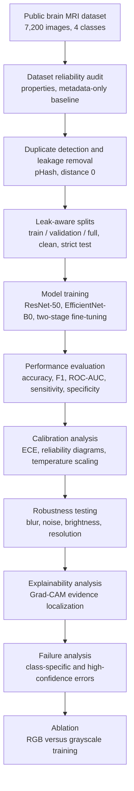
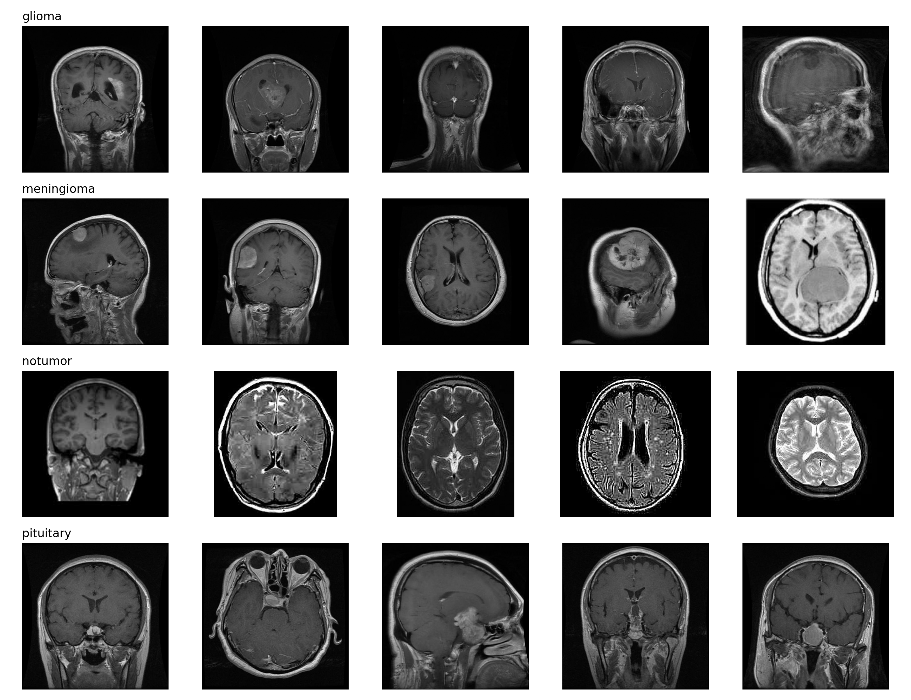
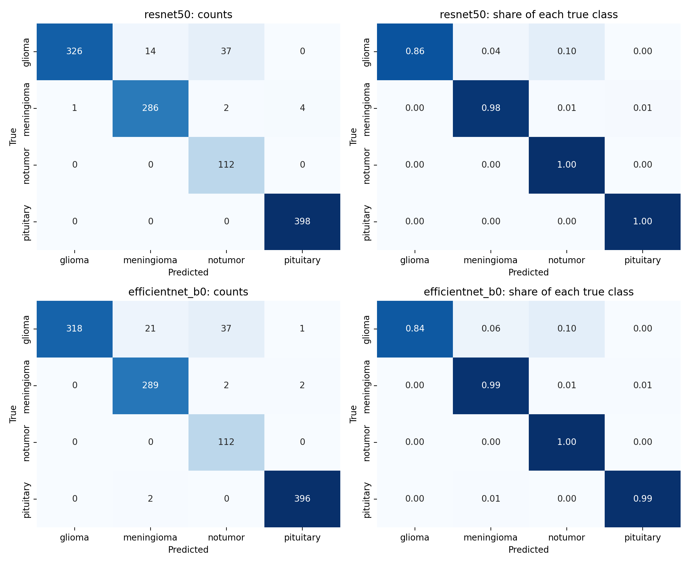

# Explainable Brain MRI Classification with Grad-CAM: Towards Explainable and Trustworthy Medical Computer Vision Systems


> **Research code and demo only. Not a medical device and not medical advice.**

**Live demo:** coming soon · **Model weights:** coming soon · **Author:** Emaan Shahid ([GitHub](https://github.com/Emaan-Shahid/))

---

## 1. Project Overview

This repository is a trustworthiness study of deep learning for 4-class brain MRI classification (glioma, meningioma, pituitary tumor, no tumor). Two ImageNet-pretrained CNNs (ResNet-50 and EfficientNet-B0) are fine-tuned, but the focus is not the accuracy figure. The study examines whether the benchmark itself is reliable, whether the models' confidence and robustness can be trusted, where and why the models fail, and what Grad-CAM can and cannot tell us about their behavior.

**Key findings (strict, leak-free test set, n = 1,180)**

| # | Finding |
|---|---|
| 1 | 23% of the official test images (370 of 1,600) had an exact copy in the training set, and about 49% of the `notumor` training images were duplicates. |
| 2 | A classifier using only file metadata (no pixels) reached 58% accuracy against 25% chance, so labels are entangled with image source and format. |
| 3 | After removing leakage, ResNet-50 and EfficientNet-B0 reached 95.1% and 94.5% accuracy. The difference is within sampling noise. |
| 4 | Both models labeled about 10% of gliomas (37 of 377) as "no tumor". Validation scores (glioma recall about 99%) had hidden this failure. |
| 5 | Confidence is informative but unsafe as an alarm: 27 of 58 (ResNet-50) and 24 of 65 (EfficientNet-B0) wrong predictions had confidence above 0.8. |
| 6 | Both models were fragile to mild blur and noise, and neither can reject non-MRI input. |
| 7 | For missed gliomas, Grad-CAM evidence for the true class more often lay outside the head (suggestive, two-sided p = 0.069). |

---

## 2. Research Motivation

Deep CNNs reach high accuracy on public medical imaging benchmarks, but a high test score does not establish that a system is reliable. Four risks are common and rarely reported together:

1. **Evaluation leakage.** Duplicates across training and test sets let a model be scored on images it has memorized.
2. **Spurious cues.** A model may use scanner, format, or source characteristics that correlate with the label in the dataset but not with disease.
3. **Miscalibrated confidence.** In clinical settings a probability is used to decide whether a human should review a case, so it must carry meaning.
4. **Opaque decisions.** Without any view of the evidence, errors are hard to detect and discuss.

Accuracy alone is insufficient in medical AI for additional reasons: classes differ in prevalence, errors have asymmetric clinical cost (missing a tumor is not equivalent to a false alarm), and a single aggregate number hides class-specific failure.

---

## 3. Research Questions

- **RQ1.** Is the public benchmark a trustworthy basis for evaluation? How much leakage and source bias does it contain?
- **RQ2.** How do two transfer-learned CNNs compare on a leak-free test set, and how uncertain are the estimates?
- **RQ3.** Is the models' confidence calibrated, and how robust are they to image degradation and invalid input?
- **RQ4.** Where and why do the models fail, and what do Grad-CAM explanations show for correct and incorrect predictions?
- **RQ5.** Are the models learning meaningful MRI features or dataset-specific visual shortcuts? (RGB versus grayscale ablation.)

---

## 4. Research Contributions

1. **A dataset reliability audit** of a widely used Kaggle brain MRI benchmark: exact-duplicate detection by perceptual hashing, class-specific contamination estimates, and a metadata-only baseline that quantifies source-label entanglement.
2. **A leak-aware evaluation protocol** with three nested test sets (full, clean, strict) so that reported performance is not inflated by memorization.
3. **A trustworthiness analysis** of ResNet-50 and EfficientNet-B0 combining calibration (ECE, reliability diagrams, temperature scaling), robustness to blur, noise, brightness and resolution changes, and input-validity failure.
4. **A failure analysis** showing that a clinically important weakness (glioma labeled "no tumor") was invisible in validation, and relating it to image source and Grad-CAM evidence.
5. **An open, reproducible implementation**: Grad-CAM written from scratch and validated against `pytorch-grad-cam`, plus an interactive demo that exposes failure cases openly.

---

## 5. Research Workflow



---

## 6. Dataset and Reliability Audit

**Data.** [Brain Tumor MRI Dataset](https://www.kaggle.com/datasets/masoudnickparvar/brain-tumor-mri-dataset) by Masoud Nickparvar (Kaggle, CC BY 4.0): 7,200 images (5,600 training, 1,600 test; 1,400 and 400 per class). It merges several public sources, and no patient identifiers are provided.

### 6.1 Image properties
- Sizes range from 150x167 to 1375x1446 px (mean about 453x457). Color modes: 4,129 RGB, 3,067 grayscale, 3 RGBA, 1 palette.
- Properties differ by class. `notumor` images are about 40% smaller on average (308x319 versus about 500x500) and 98% are stored as RGB files, versus 22% for `glioma`.




### 6.2 Duplicate and leakage audit
Each image was fingerprinted with a 64-bit perceptual hash (pHash), and images with Hamming distance 0 were treated as copies. Distance 4 was examined as a sensitivity analysis and not adopted: label-conflicting groups rose from 1 to 25, suggesting that it also matches merely similar slices.

| Result (Hamming distance 0) | Value |
|---|---|
| Test images with a copy in the training set | 370 / 1,600 (23%) |
| `notumor` test images with a training copy | 257 / 400 (64%) |
| `meningioma` test images with a training copy | 105 / 400 (26%) |
| `glioma` / `pituitary` test images with a training copy | 6 / 400 and 2 / 400 |
| Repeated images inside the test set | 126 |
| `notumor` training images that were redundant copies | about 49% |

The nominally balanced class counts (1,400 per class) were therefore partly produced by duplicating `notumor` images.

**Cleaning rule.** The official test set is never modified. Training images that duplicate a test image, one image with a conflicting label, and within-training duplicates were removed, leaving 4,738 of 5,600 training images (glioma 1,393; pituitary 1,348; meningioma 1,277; notumor 720). Three test sets are used throughout:

| Test set | Images | Definition |
|---|---|---|
| Full | 1,600 | Official test folder |
| Clean | 1,230 | No copy in the original training set |
| **Strict** (headline) | **1,180** | Clean, without repeated test images (glioma 377, meningioma 293, notumor 112, pituitary 398) |

### 6.3 Metadata-only baseline
A random forest on width, height, aspect ratio, file size, and color mode (no pixel content), trained on the cleaned training set, reached **58.3%** on the full and **55.0%** on the clean test set (chance: 25%), recovering `notumor` with 97% recall. Labels are therefore entangled with source and format. This shows that a shortcut is *possible*, not that the CNNs use it.

### 6.4 Why trustworthy evaluation matters
Exact duplicates across splits convert a generalization test into a memorization test and inflate scores. Here contamination is concentrated in two classes (`notumor` 64%, `meningioma` 26%), so it would also bias per-class comparisons, not just the average. Source-label entanglement means high accuracy can arise from recognizing the origin of an image instead of the disease, and the absence of patient IDs means that slice-level leakage between patients' images cannot be excluded even after deduplication.

---

## 7. Methodology

**Splits.** The cleaned training set was split 80/20, stratified, with a fixed seed (42): 3,790 training and 948 validation images. The test set was used only for reporting.

**Preprocessing.** Conversion to RGB, resize to 224x224, ImageNet normalization.

**Augmentation (training only).** Random resized crop (scale 0.85 to 1.0), horizontal flip, rotation up to 15 degrees, brightness and contrast jitter of 0.2.

**Training (identical for both models).** Two-stage fine-tuning: stage 1 trains only the new head for 3 epochs (lr 1e-3, backbone frozen); stage 2 unfreezes all layers for up to 12 epochs (lr 1e-4, cosine schedule). AdamW (weight decay 1e-4), batch size 32, mixed precision, label smoothing 0.1, class-weighted cross-entropy (0.85, 0.93, 1.64, 0.88 for glioma, meningioma, notumor, pituitary). The checkpoint with the lowest validation loss was kept. Early stopping (patience 4) was configured but never triggered.

**Ablation design (RQ5).** Hypothesis: *if color or file-format cues act as shortcuts, training on grayscale-converted images should reduce missed gliomas.* ResNet-50 is retrained with identical settings and a grayscale transform (replicated to 3 channels) in training and evaluation, and compared with the RGB model on the strict test set: accuracy, glioma sensitivity, missed gliomas (of 377), and missed gliomas among RGB-stored images (of 151). A second RGB run with a different seed estimates run-to-run variability. Grayscale conversion removes color only; image size, contrast and scanner style remain, so a null result does not exclude other shortcuts.

---

## 8. Models

| Model | Parameters | Pretraining | Grad-CAM layer |
|---|---|---|---|
| ResNet-50 | 23.5M | ImageNet-1k | last block of `layer4` |
| EfficientNet-B0 | 4.0M | ImageNet-1k | last feature block |

---

## 9. Evaluation Metrics

- **Classification:** accuracy, macro-averaged precision, recall and F1, one-vs-rest macro ROC-AUC, confusion matrices.
- **Per-class sensitivity and specificity** (one class versus the rest), since the cost of a missed tumor differs from that of a false alarm.
- **Calibration:** expected calibration error (ECE, 10 equal-width bins), reliability diagrams, mean confidence for correct versus wrong predictions, temperature scaling fitted on validation data.
- **Robustness:** accuracy under blur, additive gray Gaussian noise, brightness change, and downscaling.
- **Uncertainty:** 95% bootstrap confidence intervals (1,000 resamples of the strict test set) and an exact McNemar test for the paired model comparison.
- **Primary evaluation set:** the strict test set (n = 1,180).

---

## 10. Results

### 10.1 Model performance (macro averages, %)

| Model | Test set | n | Accuracy | Precision | Recall | F1 | ROC-AUC |
|---|---|---|---|---|---|---|---|
| ResNet-50 | Full | 1,600 | 94.2 | 94.7 | 94.2 | 94.2 | 0.988 |
| ResNet-50 | Clean | 1,230 | 94.6 | 92.4 | 95.7 | 93.4 | 0.989 |
| ResNet-50 | **Strict** | 1,180 | **95.1** | 92.1 | 96.0 | 93.4 | 0.990 |
| EfficientNet-B0 | Full | 1,600 | 93.5 | 94.2 | 93.5 | 93.5 | 0.987 |
| EfficientNet-B0 | Clean | 1,230 | 94.0 | 91.7 | 95.2 | 92.8 | 0.990 |
| EfficientNet-B0 | **Strict** | 1,180 | **94.5** | 91.5 | 95.6 | 92.9 | 0.990 |

TODO: add the 95% bootstrap confidence intervals and the McNemar p-value (from `results/metrics_with_ci.csv`) as a sentence here. Without intervals, a gap of 0.6 accuracy points between models should not be interpreted.

Macro precision is lower than macro recall on the strict set because few `notumor` images remain (112), so the 37 gliomas labeled "no tumor" weigh heavily on `notumor` precision (112 of 151 predictions, about 74%).


### 10.2 Per-class sensitivity and specificity (strict test set, %)

Derived from the confusion matrices below.

| Class (n) | ResNet-50 sensitivity | ResNet-50 specificity | EfficientNet-B0 sensitivity | EfficientNet-B0 specificity |
|---|---|---|---|---|
| glioma (377) | **86.5** | 99.9 | **84.4** | 100.0 |
| meningioma (293) | 97.6 | 98.4 | 98.6 | 97.4 |
| notumor (112) | 100.0 | 96.3 | 100.0 | 96.3 |
| pituitary (398) | 100.0 | 99.5 | 99.5 | 99.6 |




### 10.3 Validation versus test
Glioma recall was 99.6% (ResNet-50) and 98.2% (EfficientNet-B0) on validation, but 86.5% and 84.4% on the strict test set. A plausible reason is that validation images share sources, and possibly patients, with training images; this was not verified.

### 10.4 Ablation: RGB versus grayscale training (ResNet-50, strict test set)

| Training input | Seed | Accuracy | Glioma sensitivity | Missed gliomas (of 377) | Missed among RGB-stored gliomas (of 151) |
|---|---|---|---|---|---|
| RGB (original run) | not fixed | 95.1 | 86.5 | 37 | 37 |
| RGB (repeat) | TODO | TODO | TODO | TODO | TODO |
| Grayscale | TODO | TODO | TODO | TODO | TODO |

TODO: write 2 to 3 sentences on the outcome, stating whether the grayscale model reduced misses beyond the run-to-run difference, and what that does and does not imply.

---

## 11. Calibration Analysis

| | ResNet-50 | EfficientNet-B0 |
|---|---|---|
| ECE (raw) | 0.073 | 0.055 |
| ECE after temperature scaling (T = 0.54, fitted on validation) | 0.032 | 0.033 |
| Mean confidence, correct predictions | 0.894 | 0.903 |
| Mean confidence, wrong predictions | 0.748 | 0.719 |
| Wrong predictions with confidence > 0.8 | 27 of 58 | 24 of 65 |
| ...after temperature scaling | 46 of 58 | 44 of 65 |

Calibration asks whether a stated confidence of, say, 90% corresponds to being right about 90% of the time. On clean data both models were slightly **underconfident** (a known effect of label smoothing). Temperature scaling lowered average ECE but raised the confidence of wrong predictions, shrinking the gap between right and wrong from 0.146 to 0.104 for ResNet-50. A better average calibration therefore did not make errors easier to flag, and the demo shows raw confidence. Confidence does carry some signal: rejecting predictions below 0.8 would flag a majority of the errors, but not the 27 and 24 confident ones.


---

## 12. Robustness Analysis

| Perturbation (strict test set, accuracy %) | ResNet-50 | EfficientNet-B0 |
|---|---|---|
| None | 95.1 | 94.5 |
| Brightness x0.5 / x1.5 | 94.2 / 93.6 | 92.7 / 92.5 |
| Downscale to 60% | 94.7 | 93.7 |
| Downscale to 30% | 83.8 | 82.7 |
| Gaussian blur, radius 1 | 64.7 | 54.1 |
| Gaussian blur, radius 2 | 31.4 | 29.1 |
| Gray Gaussian noise, sigma 5 | 85.1 | 87.4 |
| Gray Gaussian noise, sigma 15 | 65.7 | **9.6** |

Both models tolerate brightness changes and moderate downscaling, but accuracy falls sharply under mild blur. At noise sigma 15, EfficientNet-B0 labeled nearly all tumor images "no tumor" (99.8%) with mean confidence 0.90, while ResNet-50 degraded more gradually. One noise seed was used per condition. An initial test with independent noise per color channel was discarded because it does not resemble scanner noise. A resolution-shift test is consistent with a source or quality dependence: shrinking tumor images to 30% raised the fraction labeled `notumor` from 3.7% to 15.3% (ResNet-50) and 13.8% (EfficientNet-B0), although part of this may reflect lost detail.

**Invalid input.** A photograph of a handwritten page was classified "no tumor" with 100% confidence and still received a plausible-looking Grad-CAM map. Softmax confidence and Grad-CAM cannot detect out-of-distribution input.

---

## 13. Explainability Analysis

Grad-CAM was implemented from scratch with forward hooks on the last convolutional block: channel weights are the spatially averaged gradients of the class score, and the map is `ReLU(sum_k w_k A_k)`, upsampled to 224x224 and scaled to [0, 1]. It matches the `pytorch-grad-cam` library (correlation about 1.00 on 8 images).

**What Grad-CAM provides.** *Evidence localization*: it indicates image regions whose features increased the score of a chosen class. It supports transparency by letting a reader check whether the evidence lies on a plausible region. **It is not causal reasoning**: it is coarse (7x7 resolution), depends on the chosen layer and class, and can look plausible even for meaningless inputs (see Section 12).

**Observations**
- For correctly classified gliomas, evidence was concentrated on or around the lesion region.
- For the 37 missed gliomas, the evidence for the true class more often lay away from the lesion: on average 25.1% of it fell outside the head, versus 7.3% for 37 randomly chosen correctly classified gliomas (15 of 37 above 20%, versus 0 of 37; the threshold was chosen after seeing the data). Mann-Whitney U: one-sided p = 0.035, **two-sided p = 0.069**, so this is suggestive and not established.
- The "no tumor" evidence for these errors typically sat on normal-looking tissue, while the visible abnormality received little weight.


---

## 14. Failure Analysis

**Where the models fail (strict test set).**

| True glioma (377) | Correct | Labeled meningioma | Labeled no tumor | Labeled pituitary |
|---|---|---|---|---|
| ResNet-50 | 326 | 14 | **37** | 0 |
| EfficientNet-B0 | 318 | 21 | **37** | 1 |

The dominant error is not glioma/meningioma confusion but glioma labeled "no tumor". All other classes have sensitivity of at least 97.6%.

**Why these errors matter.** A tumor labeled "no tumor" is the clinically costly direction, and it occurs with confidence: 27 of ResNet-50's 58 and 24 of EfficientNet-B0's 65 errors exceeded 0.8. The `notumor` class has perfect sensitivity but only about 74% precision (112 of 151 predictions), so a "no tumor" output is not reassuring.

**Patterns.**
- 31 of the 37 missed gliomas are the same images in both models, pointing to properties of the images rather than of one architecture.
- All 37 ResNet-50 misses are gliomas stored as RGB files, and none of the 226 grayscale-stored gliomas was missed (24.5% of the 151 RGB-stored gliomas). The network never sees the file mode, so this is a proxy for a different source or style. RGB-stored images make up only 16% of training gliomas (177 of 1,114), while 567 of 576 `notumor` training images are RGB.
- Validation did not reveal the problem (glioma recall about 99%).

**What Grad-CAM reveals.** For these errors the visible abnormality often receives little evidence, as described in Section 13. The relationship between image source and the errors is *consistent with* a shortcut but not proven; the ablation in Section 10.4 tests one aspect of it.

---

## 15. Demo Application

A Streamlit app (`app/streamlit_app.py`) lets a user choose a sample scan or upload an image, select a model, and see the predicted class, per-class probabilities, and a Grad-CAM map for the predicted or any chosen class, with adjustable heatmap strength. It includes the failure cases, a confidence message, a warning that "no tumor" is not reassurance, and a color/background heuristic that warns when an upload does not look like an MRI (it flagged 0.9% of real test MRIs). The heuristic is not a substitute for an out-of-distribution detector.

| Correct prediction with Grad-CAM | Known failure case |
|---|---|
|  |  |

| Input check for non-MRI images | Same scan, different model |
|---|---|
|  |  |

---

## 16. Limitations

- **Dataset.** A merged public collection without patient IDs, so patient-level leakage cannot be excluded. Only exact (distance 0) duplicates were removed, and visually near-identical slices remain, including in the test set. Labels were not verified by a clinician.
- **Single runs.** One split, and one training run per model whose seed was not fixed, so the exact weights cannot be regenerated and differences below the bootstrap uncertainty should not be interpreted.
- **Small strict `notumor` set** (112 images): per-class estimates for this class are noisy.
- **Validation optimism.** Validation scores overstated glioma performance, so model selection used a weaker signal than desirable.
- **Explainability.** Grad-CAM is coarse and qualitative. It was not compared with lesion masks. The "outside the head" statistic uses a brightness-threshold head outline, a map computed for a class the model considered unlikely, and a threshold chosen after seeing the data. The result is not significant at 0.05 when tested two-sided.
- **Robustness** used synthetic perturbations and one noise seed, not real scanner variation. No external validation set was available.
- **Shortcut hypothesis.** Evidence is indirect (metadata baseline, RGB-only misses, resolution shift) and does not establish a cause.
- **Not a clinical tool.** No radiologist evaluation.

---

## 17. Future Work

1. Patient-level splits and external validation on a different scanner or institution.
2. Quantitative localization against tumor masks (pointing game, IoU) and comparison with other attribution methods.
3. Mitigating source dependence: source-balanced sampling, resolution and contrast augmentation, blur and noise augmentation.
4. Out-of-distribution detection, an explicit "uncertain" outcome, and selective prediction with ensembles or MC dropout.
5. Multiple seeds with confidence intervals, and additional architectures.

---

## 18. Reproducibility

**Repository structure**
```
Medical-Vision-AI-XAI/
├── .streamlit/config.toml      # app theme
├── app/                        # Streamlit demo and 10 sample images
├── data/                       # manifest.csv (audit flags), splits.csv
├── docs/screenshots/           # images used in this README
├── models/                     # trained weights (not stored in git)
├── notebooks/                  # Colab notebooks: audit, training, evaluation, trust analysis, ablation
├── results/                    # figures and metric tables (CSV)
├── src/                        # preprocessing, train, evaluate, gradcam, inference
├── LICENSE
├── requirements.txt            # demo dependencies
└── README.md
```

**Run the demo**
```bash
git clone https://github.com/YOUR_GITHUB_USERNAME/Medical-Vision-AI-XAI.git
cd Medical-Vision-AI-XAI
python -m venv venv
venv\Scripts\activate            # Windows (Mac/Linux: source venv/bin/activate)
pip install -r requirements.txt
# place resnet50_best.pt and efficientnet_b0_best.pt in models/
streamlit run app/streamlit_app.py
```

**Re-run the study.** Open the notebooks in Google Colab with a T4 GPU, download the dataset from Kaggle (API token required), and run the cells in order. The notebooks read `data/manifest.csv` and `data/splits.csv`, which record the cleaning and the splits (split seed 42). Weight files are 91 MB (ResNet-50) and 16 MB (EfficientNet-B0) and are produced by the training notebook; a download link will be added.

**Acknowledgments.** Dataset: Masoud Nickparvar, *Brain Tumor MRI Dataset*, Kaggle, CC BY 4.0. Methods: Selvaraju et al., *Grad-CAM* (ICCV 2017); He et al., *ResNet* (CVPR 2016); Tan and Le, *EfficientNet* (ICML 2019); Guo et al., *On Calibration of Modern Neural Networks* (ICML 2017).

**Disclaimer.** This repository is for research and education only and must not be used to diagnose, treat, or make decisions about any medical condition.
